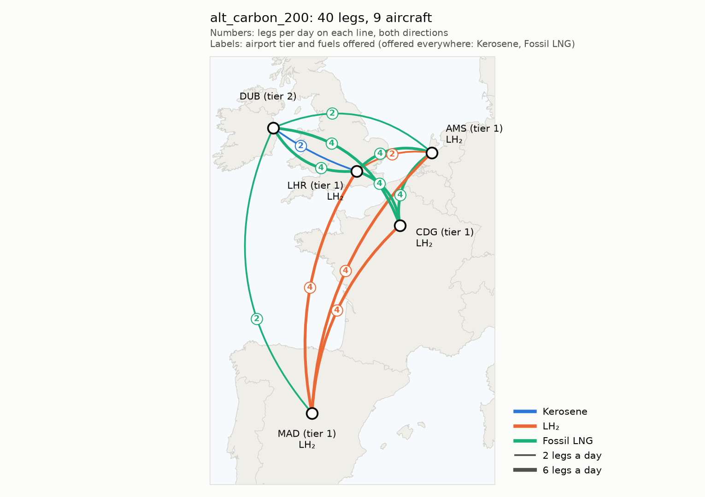

# Alternative-Fuel Fleet Transition: An Airline Network Perspective

Cambridge MEng (Part IIB) project, Hui Lin Chew, 2026–27. Supervisor: Dr Maria Vera-Morales (Whittle Laboratory).

How an airline's network, fleet and costs change as some aircraft switch from
kerosene to liquid hydrogen (LH₂) or methane. Builds on the airport-side models
of Henry Sanford and Hasan Al-Timimi.

For now it runs on a dummy network (5 airports, 40 daily legs, 3 aircraft types)
while the model structure is settled. Values come from the literature where
possible (`docs/methods.md`); the rest are marked as placeholders.

<p align="center"></p>

## Quick start

```bash
uv sync                           # install the pinned environment
uv run scripts/run_scenarios.py   # run all scenarios, write outputs/
uv run pytest                     # model checks
```

## Model

A basic fleet assignment model (Hane et al. 1995, via Sherali et al. 2006) on a
time-space network per aircraft type: each timed leg is assigned one aircraft
type (or dropped), subject to aircraft flow balance and the fleet available.
Range and fuel availability decide which types can fly which legs.

Modules follow the planning sheet:

| # | Module | File |
|---|---|---|
| 0 | Scenario config | `scenario_config.py` + `scenarios/<timetable>/*.yaml` |
| 1 | Data layer | `data_layer.py` |
| 2 | Airport capability | `airport_capability.py` |
| 3 | Aircraft performance | `aircraft_performance.py` |
| 4 | Fleet stock-flow | not yet built |
| 5 | Cost/revenue | `cost_revenue.py` |
| 6 | Network builder | `network_builder.py` |
| 7 | Optimiser | `optimiser.py` |
| 8 | Rotation checker | `rotation_checker.py` |
| 9 | Analysis | `analysis.py`, `plots.py` |

Full walk-through and every scenario setting: `docs/code_guide.md`. Sources for every method and number: `docs/methods.md`.

## First results (dummy data)

Methane = fossil LNG (e-methane available as a switch).

| Scenario | Aircraft | Legs: kerosene / LH₂ / LNG | CO₂ vs baseline | Total cost vs baseline |
|---|---|---|---|---|
| `baseline` (kerosene) | 9 | 100 / 0 / 0% | — | — |
| `alt_min_energy` | 9 | 100 / 0 / 0% | 0% | 0% |
| `alt_carbon_200` | 9 | 5 / 35 / 60% | −53% | +20% |
| `alt_carbon_200_emethane` (methane aircraft on e-methane) | 9 | 45 / 55 / 0% | −59% | +21% |
| `alt_carbon_200_spill` (150-seat LH₂, spill allowed) | 9 | 5 / 15 / 80% | −32% | +20% |
| `alt_carbon_200_drop` (legs may be dropped) | 5 | 0 / 54 / 46% | −78% | +7% |
| `alt_min_co2` | 10 | 0 / 65 / 35% | −72% | +18% |

Total cost = operating cost + aircraft ownership + revenue lost to spilled passengers and dropped legs.
No fleet caps: the model may use as many aircraft of each type as it wants (`fleet` = 100 each).
Scenarios sit in one folder per timetable (`scenarios/out_and_back/`, `chains/`, `lcc/`,
`lcc_week/`), and so do their results (`outputs/<folder>/`, figures in `outputs/<folder>/figures/`).
`scenarios/stress_tests/` (random timetables used by the tests) isn't part of the main run.

- Minimising fuel burn never picks LH₂ or methane, because they need more energy per flight.
- LNG aircraft cost +9% (Raab et al. 2024 ratio to LH₂) and refuel like LH₂ (9 min to connect,
  10.4 kg/s per pump; no LNG-specific data). With no carbon price LNG still takes 15% of legs
  (unlimited fleets: premium 0% → 100%, +5% → 65%, +7.1% → 35%, +9% → 15%, +12% → 0%), and
  65–75% from 50 USD/t.
- LH₂ takes over from LNG as the carbon price rises: 35% of legs at 200 USD/t, 55% from 250 USD/t.
  The switch point is sensitive to placeholder costs: LH₂'s +11% maintenance (Hoelzen et al. 2022,
  not applied yet) would move it to 250 USD/t.
- e-methane (29 USD/GJ) costs more than LH₂ (21 USD/GJ), so it isn't chosen at these prices.
- Airport capacity doesn't bind on this network.
- A second timetable, `data/dummy_chains/` (`chains_*` scenarios), has aircraft ending the
  day away from where they started: rotations then take up to 8 days to get back home.
  The fleet assignment handles this unchanged (it only needs each airport balanced each night).
- Stress tests (`scenarios/stress_tests/`): `data/dummy_irregular/` has 60 smaller flights
  at random times. Letting legs leave up to 60 min late (`max_delay_min: 60`) cuts the
  aircraft needed from 22 to 19 (kerosene only, 4 legs delayed) and, at 200 USD/t, moves
  kerosene legs to LH₂ and LNG (CO₂ −13%, cost −6%). Delays are free, but only kept where they help (a second solve minimises delay minutes).
- `data/dummy_chains_irregular/` (also a stress test) is the chains
  timetable with random 25–75 min ground times, so some connections are shorter than a turn.
  Fixed times need 13 aircraft instead of 11; with delays of up to 10 min it's back to 11
  aircraft, and at 200 USD/t and up to 60 min LH₂ flies 38% of legs (10% at fixed times) and
  CO₂ falls from 392 t to 233 t.
- `data/dummy_lcc/` (`lcc_*` scenarios) is low-cost-carrier style: aircraft based
  at DUB and MAD (`overnight_at_bases: true`), every line starts and ends at a base, 25-min
  turns, curfews at LHR and AMS. The timetable is built for kerosene turns, so at 200 USD/t (fleet and fuels as alt_carbon_200) LH₂ and LNG, both about
  6 min longer to refuel, fly nothing at fixed times (100% kerosene); letting legs leave up to
  30 min late, LH₂ flies 31%, LNG 58% and kerosene 11% (CO₂ 739 → 388 t). With LNG's
  connection at 6 min instead of 9, LNG takes 21% even at fixed times.
- `data/dummy_lcc_week/` (`lcc_week_*`) runs the same timetable as a week (`period_min: 10080`)
  with fewer flights at the weekend: same 9 aircraft and a similar fuel mix, every aircraft at a base
  every night; the Gantt chart shows the whole week.
- The drop, spill and capacity results only show the mechanisms work: crew and
  maintenance costs and the airline's capacity share are still placeholders.
