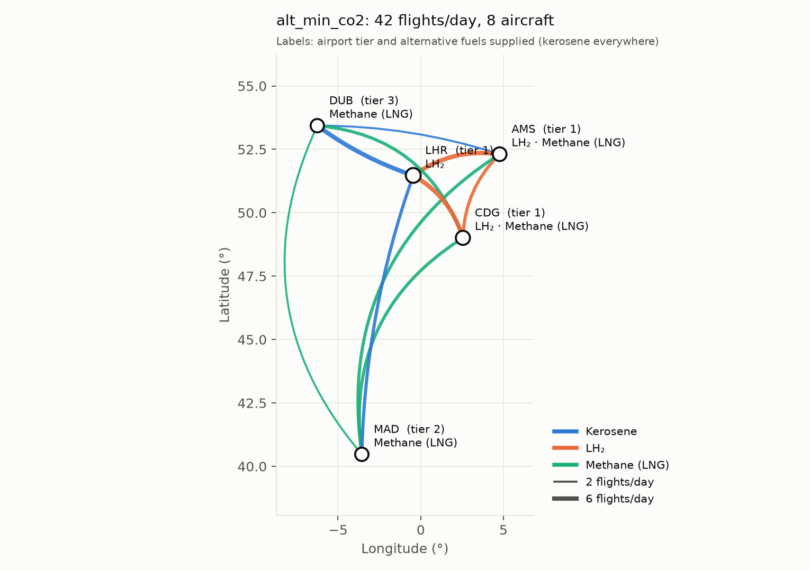

# Alternative-Fuel Fleet Transition: An Airline Network Perspective

Cambridge MEng (Part IIB) project, Hui Lin Chew, 2026–27. Supervisor: Dr Maria Vera-Morales (Whittle Laboratory).

Models how an airline's network, fleet and costs change as some aircraft switch
from kerosene to liquid hydrogen (LH₂) or methane. Builds on the airport-side
models of Henry Sanford and Hasan Al-Timimi
([hydrogen-airport-model](https://github.com/HuiLinChew/hydrogen-airport-model)).

**Status:** dummy network (5 airports, 3 aircraft types) to fix the model structure
before real data. All aircraft, fuel and price numbers are placeholders.

<p align="center"></p>

## Quick start

```bash
uv sync                       # install the pinned environment
uv run scripts/run_dummy.py   # solve all scenarios, write outputs/
uv run pytest                 # checks: demand served, balance, fuel/range, curfew
```

## How it works

| Step | Module | What it does |
|---|---|---|
| Inputs | `data.py` | Loads CSVs in `data/dummy/`; builds feasible arcs (type × route) with energy, CO₂, cost, block time per flight |
| Optimiser | `model.py` | Integer program choosing daily flights per aircraft type per route |
| Scenarios | `scenarios.py` | Changes applied as "disturbances" to input tables; results reported as deltas vs baseline |
| Tails | `rotations.py` | Chains the route plan into daily tail rotations (rule-based feasibility check, not optimised) |
| Figures | `plots.py` | Network map, tail Gantt chart, scenario comparison |

### Optimiser (fleet assignment, daily, route level)

| | |
|---|---|
| Variables | `x[k,i,j]` daily flights by type *k* on route *i→j* (integer); `n[k]` aircraft used |
| Objective | Minimise fuel **energy** (GJ), **CO₂** (well-to-wake) or **fuel cost**; tiny tie-break on fleet size |
| Demand | Seats × max load factor ≥ daily pax, every route (all passengers served) |
| Balance | Departures = arrivals per type per airport |
| Utilisation | Σ (block + turnaround) ≤ `n[k]` × operating hours (06:00–23:00) |
| Range / fuel | Arc exists only if within range **and** the fuel is available at the origin (refuel every departure, no tankering yet) |
| Slots | Movements per airport ≤ daily slots |

Fuel burn is a lookup table of energy vs distance, so non-linear curves (e.g.
from Maria) can be dropped in without changing the model: each route's distance
is fixed, so the optimisation stays linear.

## Dummy data (`data/dummy/`)

| File | Contents | Source |
|---|---|---|
| `airports.csv` | LHR, CDG, AMS, MAD, DUB: coordinates, tier (1 large hub … 6 tiny), fuels supplied, daily slots | Coordinates from Hasan's `airport_all.csv`; rest invented |
| `demand.csv` | 20 directed routes, 2015 annual pax and growth | Hasan's `segment_data.csv` (base year 2015) |
| `aircraft.csv` | KER-NB, LH2-NB, CH4-NB: seats, range, speed, turnaround, fleet limit | Placeholder |
| `fuel_burn.csv` | Energy per flight vs distance per type | Placeholder (A320-class shape) |
| `fuels.csv` | Well-to-wake CO₂ (g/MJ) and price ($/GJ) per fuel | Placeholder |

Airline modelled as carrying 15% of each route (`airline_share`), year 2015.

## Scenarios and first results

| Scenario | Change vs baseline | Aircraft | CO₂ | Fuel cost |
|---|---|---|---|---|
| `baseline` | Kerosene only, min energy | 6 | 397 t/day | $80k/day |
| `alt_min_energy` | 4 LH₂ + 4 CH₄ aircraft available, min energy | 6 | +0% | +0% |
| `alt_min_co2` | Same fleet, min CO₂ | 8 | −25% | +32% |
| `alt_min_co2_lh2_mad_dub` | Plus LH₂ supply at MAD and DUB | 7 | −51% | +104% |

Takeaways (dummy numbers, structure only):
- Minimising fuel burn alone never picks alternative fuels, since they need more
  energy per seat. The objective (or a mandate/carbon price) drives the transition.
- Fuel availability at airports is binding: adding LH₂ at two airports doubles
  the CO₂ saving.

## Layout

```
data/dummy/        input CSVs
src/altfleet/      model package
scripts/           run_dummy.py
tests/             pytest checks
outputs/           results CSVs and figures (regenerated by run_dummy.py)
```

## Next steps

- Replace placeholders: Maria's aircraft characteristics; OpenSky ADS-B data for real rotations and utilisation
- Airline operation types (low-cost, scheduled, charter); airport tiers from real data
- Capacity via Hasan's absorption factor; year-by-year fleet stock-flow
- Revenue/profit deltas; tankering option for methane
