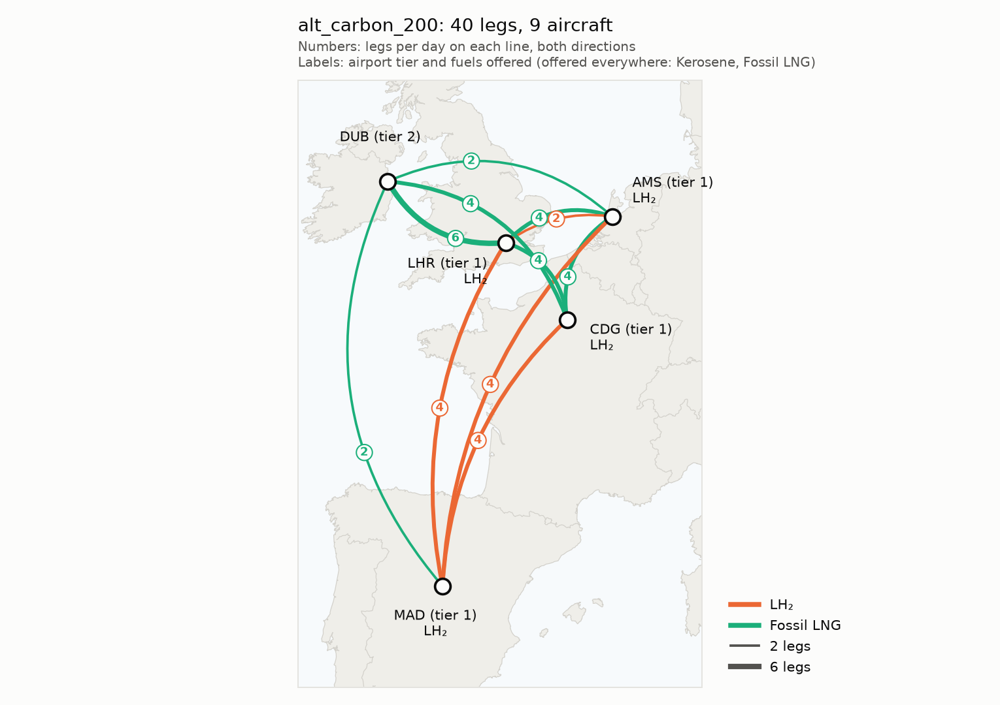

# Alternative-Fuel Fleet Transition: An Airline Network Perspective

Cambridge MEng (Part IIB) project, Hui Lin Chew, 2026–27. Supervisor: Dr Maria Vera-Morales (Whittle Laboratory).

How an airline's network, fleet and costs change as some aircraft switch from
kerosene to liquid hydrogen (LH₂) or methane. Builds on the airport-side models
of Henry Sanford and Hasan Al-Timimi.

For now it runs on a dummy network (5 airports, 40 daily legs, 3 aircraft types)
while the model structure is settled. Values come from the literature where
possible (`docs/methods.md`); the rest are marked as placeholders.

<p align="center"></p>

## Quick start

```bash
uv sync                           # install the pinned environment
uv run scripts/run_scenarios.py   # run all scenarios, write outputs/
uv run pytest                     # model checks
```

## Model

A basic fleet assignment model (Hane et al. 1995, via Sherali et al. 2006) on a
time-space network per aircraft type: each timed leg is assigned one aircraft
type (or dropped), subject to aircraft flow balance and the fleet available.
Range and fuel availability decide which types can fly which legs.

Modules follow the planning sheet:

| # | Module | File |
|---|---|---|
| 0 | Scenario config | `scenario_config.py` + `scenarios/*.yaml` |
| 1 | Data layer | `data_layer.py` |
| 2 | Airport capability | `airport_capability.py` |
| 3 | Aircraft performance | `aircraft_performance.py` |
| 4 | Fleet stock-flow | not yet built |
| 5 | Cost/revenue | `cost_revenue.py` |
| 6 | Network builder | `network_builder.py` |
| 7 | Optimiser | `optimiser.py` |
| 8 | Rotation checker | `rotation_checker.py` |
| 9 | Analysis | `analysis.py`, `plots.py` |

Full walk-through and every scenario setting: `docs/code_guide.md`. Sources for every method and number: `docs/methods.md`.

## First results (dummy data)

Methane = fossil LNG (e-methane available as a switch).

| Scenario | Aircraft | Legs: kerosene / LH₂ / LNG | CO₂ vs baseline | Total cost vs baseline |
|---|---|---|---|---|
| `baseline` (kerosene) | 9 | 100 / 0 / 0% | — | — |
| `alt_min_energy` | 9 | 100 / 0 / 0% | 0% | 0% |
| `alt_carbon_200` | 9 | 0 / 35 / 65% | −54% | +18% |
| `alt_carbon_200_emethane` | 9 | 45 / 55 / 0% | −59% | +21% |
| `alt_carbon_200_spill` (150-seat LH₂, spill allowed) | 9 | 5 / 25 / 70% | −38% | +18% |
| `alt_carbon_200_drop` (legs may be dropped) | 5 | 0 / 0 / 100% | −41% | +6% |
| `alt_min_co2` | 10 | 0 / 65 / 35% | −72% | +16% |

Total cost = operating cost + aircraft ownership + revenue lost to spilled passengers and dropped legs.

- Minimising fuel burn never picks LH₂ or methane, because they need more energy per flight.
- Fossil LNG beats kerosene even with no carbon price, but only because there's no
  sourced price premium for LNG aircraft yet (it's 0%). At +5% the LNG share halves,
  and at +12% it disappears, so methane results shouldn't be used until this is sourced.
- LH₂ takes over from LNG as the carbon price rises: 35% of legs at 200 USD/t, 55% from 300 USD/t.
- e-methane (29 USD/GJ) costs more than LH₂ (21 USD/GJ), so it isn't chosen at these prices.
- Airport capacity doesn't bind on this network.
- The drop, spill and capacity results only show the mechanisms work: crew and
  maintenance costs and the airline's capacity share are still placeholders.
